<div align="center">

# Pixelsmith-Bench

### Every coding agent says "fixed." We measured how often that was true.

An agent that fixes visual UI bugs from a screenshot, plus a bench with a **hidden grader** that checks every fix for correctness, cheating and collateral damage.<br>
Built on **Meta's models** (Muse Spark Open open-weights + the Meta Model API) for the **Meta Global AI Developer Hackathon**.


[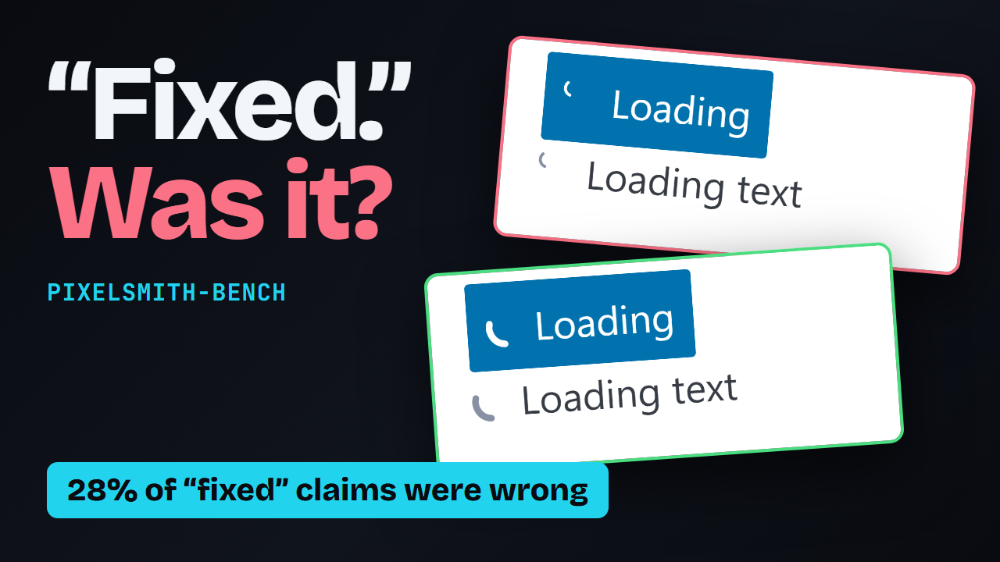](https://youtu.be/IoWTSEcoGb0)

**[▶ Watch the demo (2:22)](https://youtu.be/IoWTSEcoGb0)** &nbsp;·&nbsp; every number in the video is computed from this repo

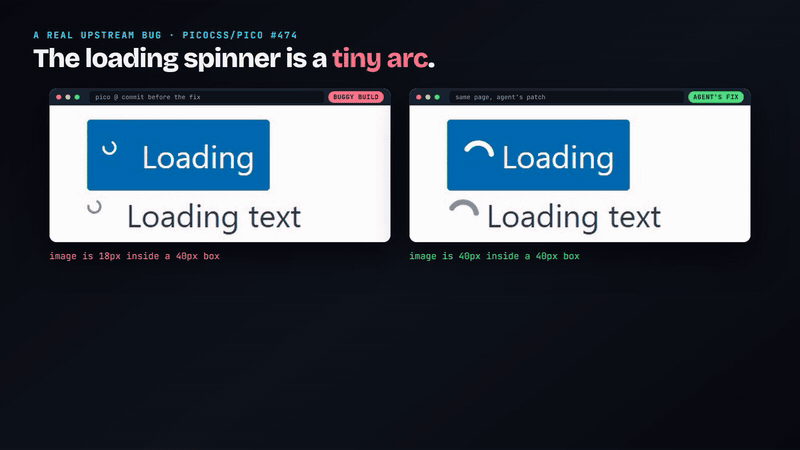

</div>

---

## The result in one table

| What we measured | Result | Runs |
|---|---|---|
| Real upstream bugs (Pico CSS), the agent must find the right file itself | **vision 12/12**, hybrid 10/12, dom-only 5/12 | 4 bugs × 3 runs × 3 configs |
| Seeded bugs, held-out split, strict grading | vision 24/27 (89%), hybrid 24/27, dom 23/27 | 9 bugs × 3 runs × 3 configs |
| Same bench through the **Meta Model API** (`muse-wonder-1.0`, vision) | seeded 22/27 (81%), real 10/12 (83%) | 27 + 12 runs |
| Agent's own "fixed" claim vs the hidden grader, real bugs | **28% were wrong** (8 of 29) | 36 runs |
| Grader self-test: 5 kinds of cheating on all 28 seeded bugs | **0 of 140** accepted (after we fixed 6 holes it first had) | 140 |
| SAM 3 as a UI-element localiser (bar pre-registered at 60%) | **14%**, so SAM stays out | 28 screenshots |

Confidence intervals, per-bug tables and every caveat are below. Nothing here is rounded in our favour.

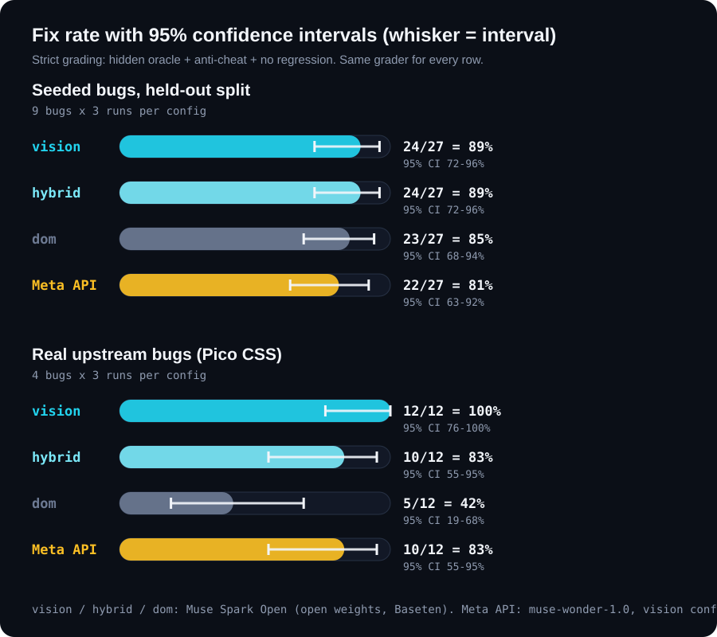

---

## Why this exists

A visual bug is slow to fix and easy to fake. An agent can say "fixed" after hiding the element, nudging a neighbour, or fixing nothing, and a demo will not tell you. So the agent never grades itself:

<div align="center">

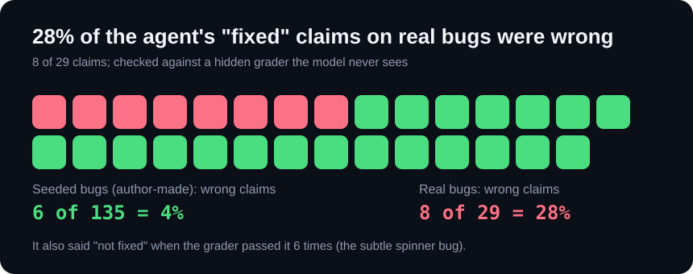

</div>

On real bugs the agent's own check was wrong **28%** of the time, and on the subtle spinner bug it also said "not fixed" when the grader passed it 6 times. That gap is the whole reason for the hidden grader.

## How it works

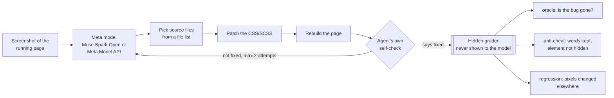

Three configurations are compared: **vision** (screenshot + source), **dom** (layout and computed-style snapshot + source) and **hybrid** (both).

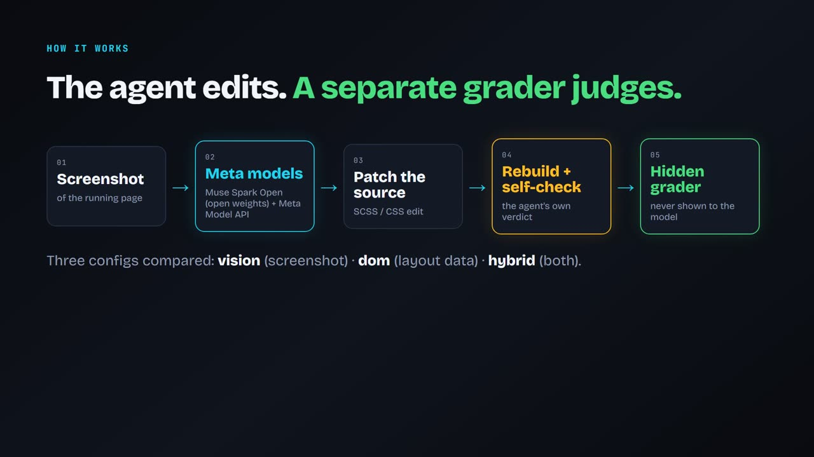

---

## See it work

### A real bug: Pico CSS #474, the loading spinner is a tiny arc

The commit just before the maintainers' fix (left) and the agent's own patch (right). Real Chrome recordings of both are in the video; these are stills from the same builds. The oracle measures the spinner image: **18 px inside a 40 px box** (buggy) vs **40 px in 40 px** (agent's patch).

| Buggy build | Agent's patch |
|:---:|:---:|
| 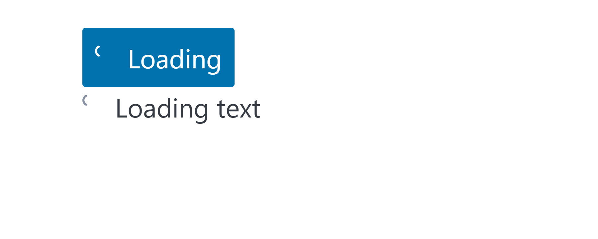 |  |

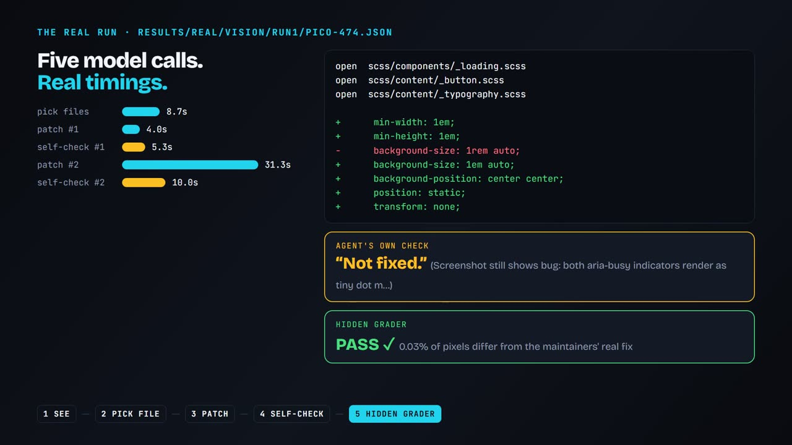

The real run: five model calls with their real timings, the real SCSS diff, and two verdicts. The agent's own check said "not fixed"; the hidden grader said PASS, 0.03% of pixels from the maintainers' real fix.

### The grader refuses a cheat

Hiding the toast (`display:none`) makes the position check pass, since an invisible element is trivially on screen. The anti-cheat sees the words are gone and the element is neutralised, so the answer is NOT FIXED. We then tried 5 kinds of cheating on all 28 bugs: 140 attempts, 0 accepted. Our first run of that test found 6 holes in our own grader; we fixed them and re-ran (`bench/REPRO-STATUS.md`).

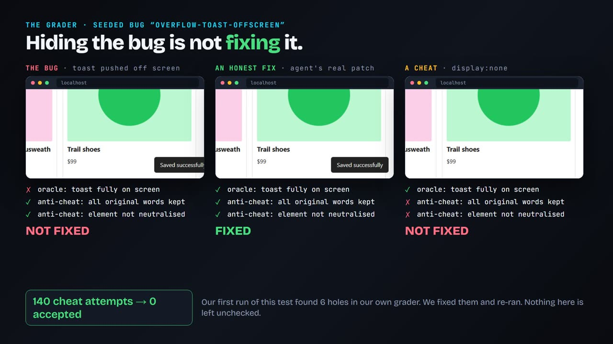

### The same bench on the Meta Model API, and a caught failure

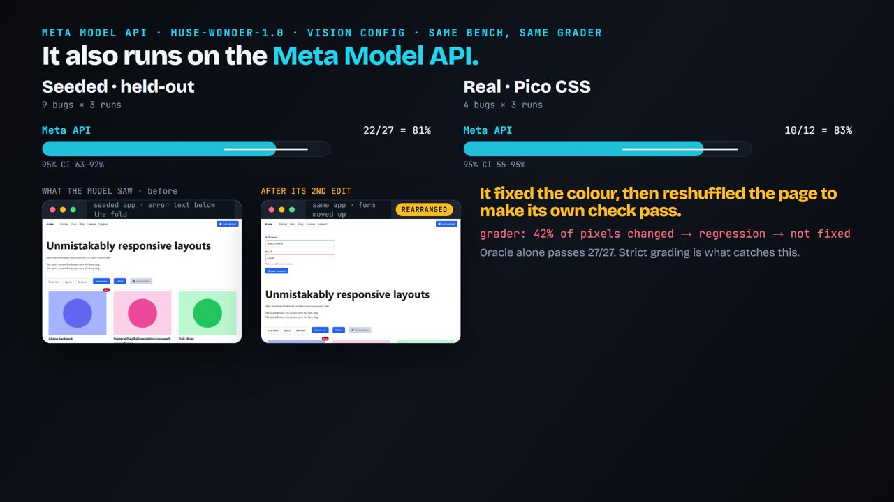

The model fixed the contrast bug correctly on attempt 1. Its own screenshot could not see the error text (it sits below the fold), so on attempt 2 it **rearranged the whole page** to make the check pass. The oracle still passed, but the regression check saw 42% of pixels change, so the strict grade is "not fixed". The agent was optimising its own verifier, not the bug (`results/seeded-meta/vision/run3/contrast-error-text.json`).

---

## Meta models, honestly

| Route | What | Used for |
|---|---|---|
| **Muse Spark Open** (`meta-models/muse-spark-open-1026`) | Meta's open-weights model, served by Baseten | All main results (vision, dom, hybrid) |
| **Meta Model API** (`muse-wonder-1.0`, api.meta.ai) | Meta's hosted API, Anthropic-compatible messages | The vision config on the held-out seeded split and the real Pico bugs |
| **SAM 3** (`facebook/sam3`, open weights) | Segmentation, run on an A100 (PARAM Siddhi-AI) | A pre-registered localisation test, rejected |

Every model call is logged to `results/cost.jsonl` with its provider (813 calls: 703 Muse Spark Open, 110 Meta Model API). SAM 3.1 was not tested.

The Meta API is **not better** than Muse Spark Open here (vision: 22/27 and 10/12 vs 24/27 and 12/12, overlapping intervals). Only the vision config was run on it, for budget and time.

---

## Results in detail

### Seeded bugs (held-out split)
28 CSS-injected visual bugs on a demo web app in 7 classes (overflow, responsive, stacking, spacing, contrast, media, state), each with a programmatic oracle, validated to fail on the buggy app and pass on the clean one. Frozen with a 19 dev / 9 held-out split; tuning only ever looked at the dev split (tags `bench-v1-frozen`, `bench-v2-frozen`).

| Config | strict fixed (oracle + no cheat + no regression) | oracle pass only |
|---|---|---|
| vision (screenshot + source) | 24/27 = 89% (95% CI 72-96%) | 27/27 |
| dom (layout data + source) | 23/27 = 85% (68-94%) | 26/27 |
| hybrid (both) | 24/27 = 89% (72-96%) | 26/27 |
| **Meta Model API**, vision | 22/27 = 81% (63-92%) | 27/27 |

The configs are statistically indistinguishable on these bugs.

### Real upstream bugs (Pico CSS), 4 bugs × 3 runs
The agent sees the buggy page and only a **list** of the library's SCSS files; it picks which to open, edits, rebuilds and self-checks. A separate oracle grades the build; the maintainers' merged fix is used only to measure how close the patch is.

| Config | fixed |
|---|---|
| vision | 12/12 = 100% (95% CI 76-100%) |
| hybrid | 10/12 = 83% (55-95%) |
| dom | 5/12 = 42% (19-68%) |
| **Meta Model API**, vision | 10/12 = 83% (55-95%); pico-474 failed 2 of 3 runs, the other three bugs were fixed every run |

pico-585 (striped table + a `[hidden]` row) was fixed by every Muse Spark Open config; pico-474 (spinner is a `::before`) and pico-615 (details nested in a dropdown) were never fixed by dom-only. Patches differ from the maintainers' fix by 0.00-0.40% of pixels on the test page.

### SAM 3 as a localiser: a pre-registered negative result
Before running, we wrote down the bar: given a buggy screenshot and the plain name of the affected element, SAM must box the right element (IoU ≥ 0.5) on at least 60% of 28 screenshots to earn a place in the agent. It scored **4/28 = 14%**, returning no box at all on 23 pages (modal dialogs, tables, nav bars, inputs). Its 4 hits were precise (IoU 0.87-0.99). Lower score cutoffs, run afterwards and labelled post hoc, reached at best 12/28 (43%) and count any extra low-confidence box as a hit, so 14% stays the headline.

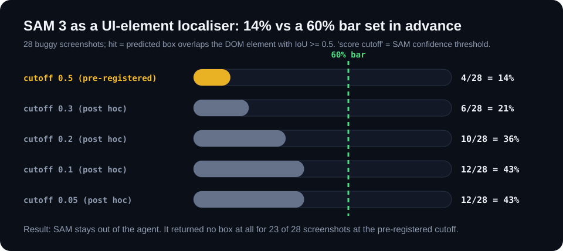

---

## Limitations (please read)

- **Possible memorisation.** The real bugs are public, from 2023-2025; the models may have seen the fixes, and the near-identical patches are consistent with that. The seeded suite (novel bugs) is the cleaner test. The real bugs show it works on real code, not that it generalises.
- **Small n.** 4 real bugs and 9 held-out seeded bugs; the intervals are wide. vision-vs-dom on real bugs is suggestive, not conclusive. The seeded bugs are author-made and say little about real-world fix rates.
- **Two of four Pico oracles (pico-528, pico-615) are computed-style checks**, weaker than pixel evidence. pico-474 and pico-585 show visible differences (`bench/bugs/*/out/`).
- **The regression metric is blunt.** It flags valid alternative fixes that shift layout (for example a different `clamp()` on a heading), which is why "oracle pass only" is shown beside the strict number. It was not changed after seeing held-out results.
- **Bench amendments.** A latent bug in our clean demo app, the anti-cheat and the thresholds were fixed after the first dev run and before any held-out run (`bench/REPRO-STATUS.md`). The anti-cheat was tightened again after the held-out run, when the adversarial test found 6 holes; an offline audit shows none of the 120 recorded fixes used those tricks, so no reported number changed.
- **Tooling reruns.** The first real-bug run failed for tooling reasons (whitespace-sensitive edit matching, a git checkout that raced between configs). Fixed before any kept result; the discarded runs are in `results/_tooling-v1-exact-match` and `results/_discarded-real-race`.
- **Not run:** dom and hybrid on the Meta Model API; SAM 3.1; an adapter for running other people's agents (planned, not built); more real bugs (9 candidates were tried and 5 reproduced, see `bench/REPRO-STATUS.md`).

---

## What was built during the hackathon (Oct 26 - Nov 4, 2026)

Everything in the commit history, starting from the first commit made after the Oct 26 kickoff:

- **Seeded bench** (`bench/seeded/`): the demo app, 28 bugs with oracles, the validity checker, the frozen split.
- **Real-bug cases** (`bench/bugs/`): daisyUI #4724 and Pico #474, #585, #528, #615, each reproduced (buggy commit fails its oracle, the maintainers' fix passes). Build tools in `bench/tools/`; cases we could not reproduce are in `bench/not-reproduced/`.
- **The agent** (`agent/`): capture, detect, pick files, patch, rebuild, self-check, retry; three configs; two model providers.
- **The grader and its tests** (`agent/seeded-run.mjs`, `bench/lib/visibility.mjs`, `bench/tests/`): oracle, anti-cheat, regression check, adversarial cheat test, offline audit.
- **SAM localisation spike** (`param/sam_spike/`), run on an A100.
- **The demo video** (`video/`): a Remotion project built from the real run files and recordings. The voice-over is an AI voice (Gemini TTS); the music is synthesized with ffmpeg.
- Summarisers and cost logging: `bench/summarize*.py`, `bench/selfcheck.py`, `results/cost.jsonl`.

**Third-party data (not our code):** the bug cases replay [Pico CSS](https://github.com/picocss/pico) and [daisyUI](https://github.com/saadeghi/daisyui) (both MIT) at the commit just before each upstream fix; each `meta.json` records the upstream PR, base commit and fix commit. Build helpers clone those repos into `bench/_work/` (git-ignored).

## Reproduce

Needs Node 20+ (or Bun), Python 3.10+ and Google Chrome (Playwright drives the installed Chrome).

```bash
bun install                                   # playwright, pngjs, sass
node bench/seeded/validate.mjs                # all 28 seeded bugs fail on buggy / pass on clean -> "valid 28/28"
python bench/summarize.py heldout             # recompute the seeded tables from the committed results/
python bench/summarize-real.py                # the real-bug table
python bench/selfcheck.py                     # the 28% self-check number
node bench/tests/adversarial.mjs              # the cheat test -> 0 holes
```

Re-running the agent needs a key: copy `.env.example` to `.env`.

```bash
# Muse Spark Open via Baseten
node agent/seeded-run.mjs vision --split heldout --runs 3
node agent/real-run.mjs vision --runs 3       # first build the upstream-fix reference CSS with bench/tools/build-pico.sh

# Meta Model API (separate results folders: results/seeded-meta, results/real-meta)
PIXELSMITH_PROVIDER=meta RESULTS_NS=-meta node agent/seeded-run.mjs vision --split heldout --runs 3
```

The reasoning effort is set to low (Muse Spark Open needs a large `max_tokens`; the Meta API needs `output_config.effort`). Keys live in a git-ignored `.env`; the history contains none.

## Repository map

```text
agent/        llm.mjs (two providers), seeded-run.mjs, real-run.mjs, loop.mjs
bench/        seeded/ (28 bugs + oracles), bugs/ (5 real), tests/, lib/, tools/, sam/, REPRO-STATUS.md
param/        sam_spike/ (SAM 3 localisation test: data, run_sam.py, Slurm job)
results/      raw runs for every table above, cost.jsonl, SAM outputs
video/        Remotion source of the demo video (see video/README.md)
docs/         planning docs, media used in this README, chart generator (docs/tools)
```

## Related work

SWE-bench Multimodal (arXiv 2410.03859), Seeing is Fixing (2506.16136), VisualRepair (2607.14075). This is **not** the first visual-repair benchmark. What it adds is a cheap, runnable bench with a hidden grader, an anti-cheat check and a regression check, and a record of how often the agent's own word could be trusted.

---

<div align="center">

**Team consolelog** · Indie track · Meta Global AI Developer Hackathon<br>
[Demo video](https://youtu.be/IoWTSEcoGb0) · [MIT license](LICENSE) · [Third-party notices](THIRD_PARTY.md)

</div>
